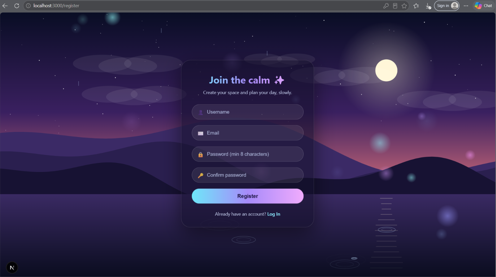
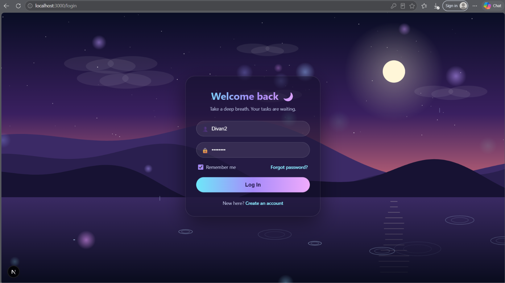
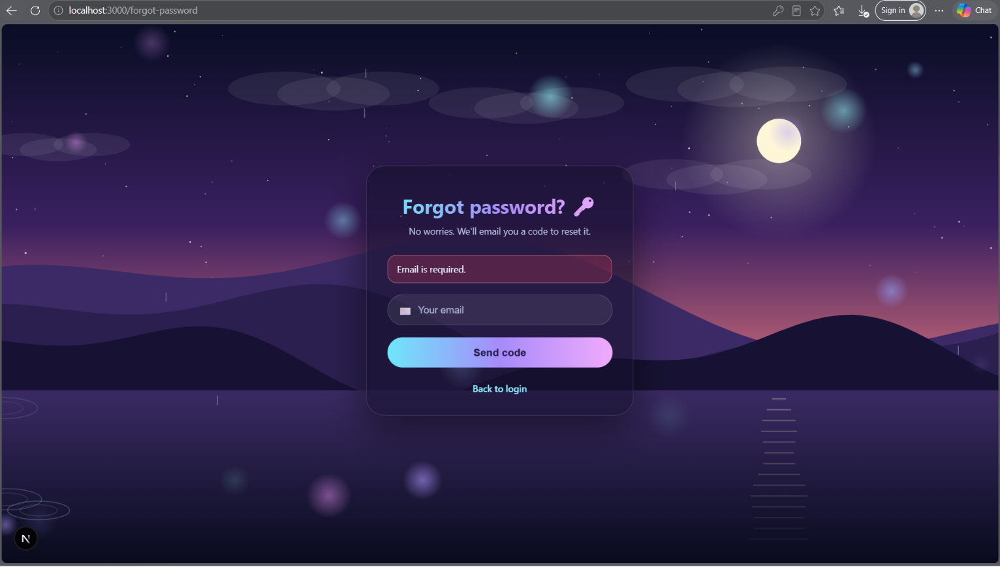
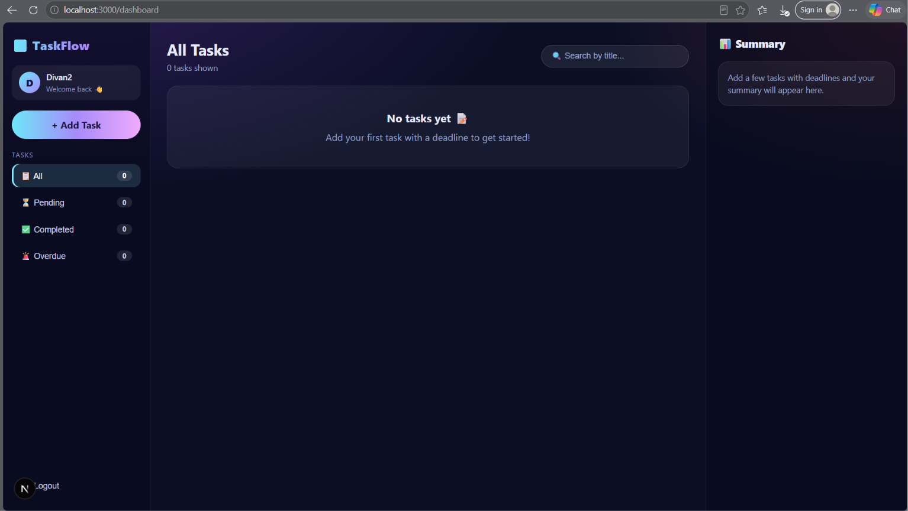
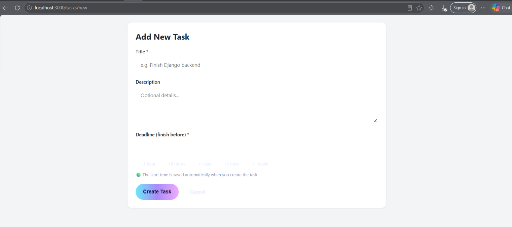

# TaskFlow - Django + Next.js To-Do List

A full-stack To-Do List application. Users can register (with email OTP verification), log in, and manage their own tasks with deadlines. The Next.js frontend talks to a Django REST Framework API backed by a MySQL database.

## Screenshots

## Screenshots







## Features

### Mandatory
- Registration (username, email, password, password confirmation) and login with username or email
- Logout, protected dashboard (unauthenticated users are redirected to login)
- Secure password hashing (Django PBKDF2)
- Create, view, edit and delete tasks (title, description, deadline)
- Mark tasks as completed or pending
- Task creation date and time displayed
- Filter tasks: All / Pending / Completed
- Dashboard summary counts (total, completed, pending)
- Users can only see and manage their own tasks
- Empty state, loading indicators, form validation, success and error messages
- Responsive layout

### Optional features completed
- Email registration verification with a 6-digit OTP
- Forgot password / reset password using an emailed OTP
- Email configuration (console backend for development, Gmail SMTP for real emails)
- "Continue with Google" login
- Search tasks by title
- Deadlines with a live countdown timer and a time-used progress bar
- Overdue filter and a summary panel (completed on time vs late, overdue, due soon, insights)

### Optional features NOT completed
- Task priorities, pagination, dark-mode toggle, online deployment

## Technology Stack

| Layer | Technology |
|---|---|
| Backend | Python, Django 5.2 LTS, Django REST Framework |
| Frontend | Next.js, React |
| Database | **MySQL 8.0** |
| Authentication | DRF Token Authentication |
| MySQL driver | PyMySQL |
| Email | Django email (console / Gmail SMTP) |
| Social login | Google Identity Services (`@react-oauth/google`, `google-auth`) |

Django 5.2 LTS is used because Django 6 requires MySQL 8.4 or newer.

## Prerequisites

- Python 3.12 or newer (tested with Python 3.15)
- Node.js 20 or newer with npm (tested with Node 24)
- MySQL Server 8.0 or newer (MySQL Workbench is optional)
- Git

## Project Structure

```
django-nextjs-todo/
|-- backend/
|   |-- config/            Django settings and root URLs
|   |-- tasks/             Models, serializers, views, OTP helper, URLs
|   |-- manage.py
|   |-- requirements.txt
|   |-- .env.example
|-- frontend/
|   |-- app/               Next.js pages (login, register, dashboard, tasks...)
|   |-- components/        Reusable UI components
|   |-- context/           Authentication context
|   |-- lib/               API helper and time/summary helpers
|   |-- package.json
|   |-- .env.example
|-- screenshots/
|-- .gitignore
|-- README.md
```

## Getting Started

### 1. Clone the repository

```
git clone https://github.com/Divaranan/django-nextjs-todo.git
cd django-nextjs-todo
```

### 2. Set up MySQL

Install MySQL Server and remember the root password. Then create the database
(MySQL Workbench or the `mysql` command line):

```sql
CREATE DATABASE todo_db CHARACTER SET utf8mb4 COLLATE utf8mb4_unicode_ci;
```

### 3. Run the Django backend

Windows (Command Prompt):

```
cd backend
python -m venv venv
venv\Scripts\activate
pip install -r requirements.txt
copy .env.example .env
```

macOS / Linux:

```
cd backend
python3 -m venv venv
source venv/bin/activate
pip install -r requirements.txt
cp .env.example .env
```

Open `backend/.env` and fill in the values (see "Environment Variables"). Generate a secret key with:

```
python -c "from django.core.management.utils import get_random_secret_key; print(get_random_secret_key())"
```

Run the migrations and start the server:

```
python manage.py migrate
python manage.py runserver
```

The API is now available at http://127.0.0.1:8000/api/

### 4. Run the Next.js frontend

Open a second terminal:

```
cd frontend
npm install
```

Windows: `copy .env.example .env.local` / macOS, Linux: `cp .env.example .env.local`

```
npm run dev
```

Open http://localhost:3000 (use `localhost`, not `127.0.0.1`, because of the CORS setting).

## Environment Variables

### backend/.env

| Variable | Description |
|---|---|
| `SECRET_KEY` | Django secret key |
| `DEBUG` | `True` for development |
| `DB_NAME` | MySQL database name (`todo_db`) |
| `DB_USER` | MySQL user (e.g. `root`) |
| `DB_PASSWORD` | MySQL password |
| `DB_HOST` | `127.0.0.1` |
| `DB_PORT` | `3306` |
| `EMAIL_BACKEND` | `django.core.mail.backends.console.EmailBackend` prints OTP emails in the backend terminal (default for development). Use `django.core.mail.backends.smtp.EmailBackend` to send real emails |
| `EMAIL_HOST`, `EMAIL_PORT`, `EMAIL_USE_TLS` | SMTP settings (Gmail: `smtp.gmail.com`, `587`, `True`) |
| `EMAIL_HOST_USER`, `EMAIL_HOST_PASSWORD` | SMTP login (for Gmail use an App Password) |
| `DEFAULT_FROM_EMAIL` | Sender address |
| `GOOGLE_CLIENT_ID` | Google OAuth client ID (optional, enables Google login) |

### frontend/.env.local

| Variable | Description |
|---|---|
| `NEXT_PUBLIC_API_URL` | Backend API URL, `http://127.0.0.1:8000/api` |
| `NEXT_PUBLIC_GOOGLE_CLIENT_ID` | Same Google client ID (optional) |

### Optional: real emails and Google login

- **Gmail SMTP:** enable 2-Step Verification on the Google account, create an App Password, then set the SMTP variables in `backend/.env`.
- **Google login:** in Google Cloud Console create an OAuth client ID (Web application) with `http://localhost:3000` as an authorized JavaScript origin, then set the client ID in both `.env` files. While the OAuth consent screen is in "Testing" mode, add your Google account as a test user.

Without these two optional settings the app still works: OTP codes are printed in the backend terminal and the Google button is hidden.

## Authentication Approach

The project uses **DRF Token Authentication**.

1. After a successful login, OTP verification or Google sign-in, the backend returns a token.
2. The frontend stores it (`localStorage` when "Remember me" is ticked, otherwise `sessionStorage`) and sends it with every request:
   `Authorization: Token <token>`
3. All task endpoints require authentication. The queryset is filtered by `request.user`, so another user's task returns **404**.
4. Logout deletes the token on the server. Resetting a password also invalidates existing tokens.
5. Passwords are hashed by Django. OTP codes are stored hashed, expire after 10 minutes, allow 5 attempts, and can be resent after 30 seconds.
6. New accounts stay inactive until the email OTP is verified.

## API Endpoints

Base URL: `http://127.0.0.1:8000/api`

| Method | Endpoint | Auth | Purpose |
|---|---|---|---|
| POST | `/auth/register/` | No | Register (`username`, `email`, `password`, `password2`) and email an OTP |
| POST | `/auth/verify-email/` | No | Verify OTP (`email`, `otp`), returns token and user |
| POST | `/auth/resend-otp/` | No | Resend the verification OTP (`email`) |
| POST | `/auth/login/` | No | Login (`username` = username or email, `password`), returns token |
| POST | `/auth/google/` | No | Google sign-in (`credential`), returns token |
| POST | `/auth/forgot-password/` | No | Email a reset OTP (`email`) |
| POST | `/auth/reset-password/` | No | Reset password (`email`, `otp`, `password`, `password2`) |
| POST | `/auth/logout/` | Yes | Log out (deletes the token) |
| GET | `/tasks/` | Yes | List own tasks (`?status=pending` or `?status=completed`) |
| POST | `/tasks/` | Yes | Create a task (`title`, `description`, `due_date`) |
| GET | `/tasks/{id}/` | Yes | Retrieve one task |
| PUT / PATCH | `/tasks/{id}/` | Yes | Update a task (also used to mark completed or pending) |
| DELETE | `/tasks/{id}/` | Yes | Delete a task |
| GET | `/tasks/stats/` | Yes | Counts: total, completed, pending |

## Known Limitations

- No automated tests; features were tested manually.
- Tokens do not expire automatically (they are removed on logout or password reset).
- The token is kept in browser storage, which is simple but less secure than HttpOnly cookies.
- No pagination, task priorities or dark-mode toggle.
- Tasks created before the deadline feature may have no deadline.
- Gmail SMTP has daily sending limits.
- Not deployed online; runs locally only.